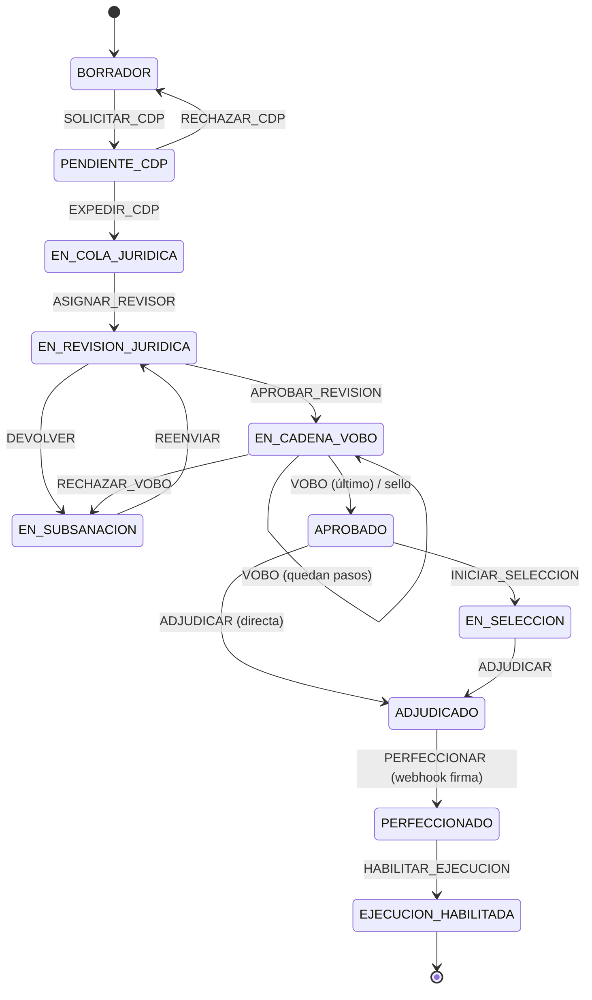
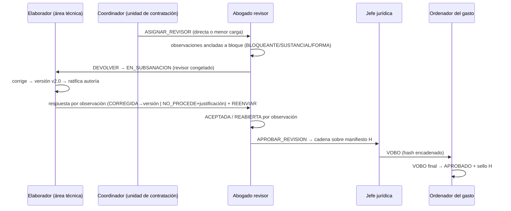
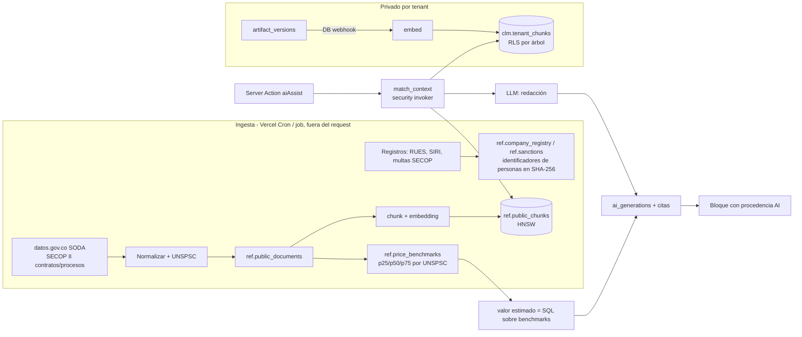
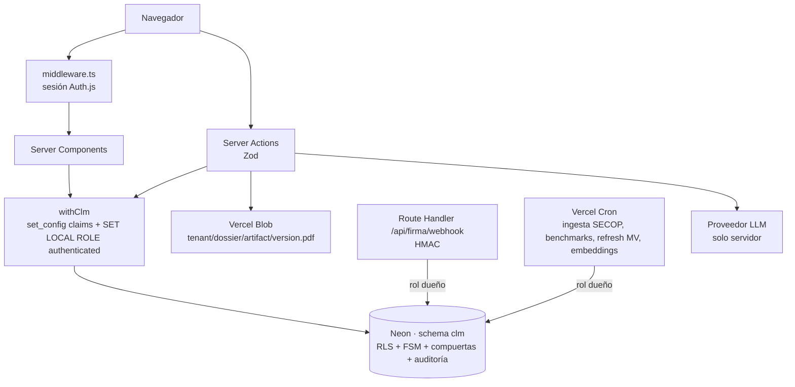

# 04 — Especificación técnica: Core Engine CLM (sector público)

> Estado: **v1 sobre Neon — 22 oct 2026**. Ejecutable: el esquema corre, pasa la prueba end-to-end y tiene una primera vista (`/expedientes`).
>
> | Artefacto | Ruta |
> |---|---|
> | DDL + RLS + PL/pgSQL (FSM, compuertas, auditoría, RAG), schema `clm` | [`prisma/migrations/20261022120000_clm_core/migration.sql`](../prisma/migrations/20261022120000_clm_core/migration.sql) |
> | Prueba end-to-end (todo el ciclo, 40+ aserciones) | [`prisma/tests/clm_core_test.sql`](../prisma/tests/clm_core_test.sql) · `bash prisma/tests/run.sh` |
> | Sesión con RLS desde Prisma | [`src/lib/db/clm.ts`](../src/lib/db/clm.ts) |
> | Contratos Zod + interfaces TS · Server Actions | [`src/modules/clm/schema.ts`](../src/modules/clm/schema.ts) · [`src/modules/clm/actions.ts`](../src/modules/clm/actions.ts) |
> | Vista del expediente con checklist de compuertas | [`src/app/expedientes/`](../src/app/expedientes/) |

> **Decisión de stack (22 oct 2026): se queda en Neon + Prisma + Auth.js.** El SQL es Postgres estándar; lo que en Supabase dan `auth.*` y PostgREST aquí lo da la app:
>
> - Todo el modelo vive en el schema **`clm`**. Prisma solo gestiona `public`, así que `prisma migrate` no ve estas tablas como deriva.
> - `clm.tenants` y `clm.users` **extienden** `public."Tenant"` y `public."User"`. Los ids son los `cuid` de Prisma (`text`); el resto de entidades usa `uuid`.
> - `auth.jwt()` / `auth.uid()` son un shim que lee `request.jwt.claims`. `withClm()` los fija por transacción desde la sesión de Auth.js y baja al rol `authenticated`, de modo que la RLS se aplica en todo lo que el usuario dispara.
> - **No hay `service_role`**: las tareas de sistema (webhook de firma, ingesta) corren con el rol dueño de las tablas, que no pasa por RLS, y declaran `{"role":"service_role"}` en los claims para la FSM.
> - **Archivos en Vercel Blob**, no en Supabase Storage: ruta `{tenant}/{dossier}/…`, y el acceso se autoriza en la app con `app.can_read_dossier`.
> - El wrapper tenant-scoped de Prisma (`src/lib/db/tenant-scope.ts`) sigue sirviendo al módulo de contratistas existente; el CLM no lo usa.

---

## 1. Principios

1. **La base de datos es la autoridad.** Las reglas que tienen consecuencias legales (quién puede actuar, qué compuerta bloquea, qué es inmutable) viven en PostgreSQL. Zod y la UI solo adelantan el rechazo y mejoran el mensaje. Si alguien se salta la app, la BD sigue diciendo que no.
2. **Un solo escritor de estado.** `clm.transition()` es la única vía para mover un expediente. Un trigger rechaza cualquier otro `UPDATE` de los campos que controla la FSM, incluso para el rol dueño de las tablas.
3. **FKs compuestas `(tenant_id, id)`.** Además de la RLS, ninguna fila puede apuntar a otra de un tenant distinto: lo impide el motor relacional, no una política.
4. **Evidencia append-only y encadenada.** Versiones, ratificaciones, respuestas y bitácora no admiten `UPDATE`/`DELETE`/`TRUNCATE`. La bitácora y los VoBo llevan hash encadenado: una manipulación se detecta (está probado).
5. **Configurable sin código.** Tipologías, delegación, cadena de VoBo, compuertas por rigor, reglas normativas y plantillas son datos por tenant. Los requisitos legales mínimos (`hard_checks`) no se pueden desactivar.

---

## 2. Modelo organizacional

```
tenants ─┬─ organizational_units (árbol: parent_id + path uuid[] raíz..self)
         ├─ users (1:1 auth.users, un tenant)
         ├─ user_memberships (user × unit × role × scope)
         └─ review_delegations (unidad origen [+ tipología, cuantía] → unidad revisora)
```

**Jerarquía.** `organizational_units.path` es la lista de ancestros incluido el propio nodo; la mantiene un trigger (también en cascada al mover un subárbol) y rechaza ciclos. "¿X está bajo Y?" se responde con `Y = any(X.path)`: un array nativo con índice GIN, sin `ltree` ni CTE recursivas en el camino caliente.

**Roles con alcance.** Un rol es una membresía `(user, unit, role, scope)`:

| scope | Cubre |
|---|---|
| `UNIT` | Solo esa unidad |
| `SUBTREE` | La unidad y todo lo que cuelga de ella (p. ej. ordenador del gasto de una Secretaría) |
| `TENANT` | Toda la entidad (p. ej. presupuesto central, auditoría) |

`app.user_covers(user, roles[], unit)` es la primitiva de autorización. Todo lo demás se arma sobre ella. Las membresías tienen vigencia (`valid_from`/`valid_to`), así que los encargos temporales no requieren borrar nada.

**Contratación centralizada o descentralizada.** `app.resolve_review_unit()` sube por el `path` de la unidad origen y toma la delegación del ancestro **más cercano** que aplique a la tipología y la cuantía. Si no hay ninguna, toma la `JURIDICA_CENTRAL` del tenant.

```
Secretaría de Salud ──delegación──▶ Unidad de Contratación Salud   (descentralizada)
  └─ Salud Pública                   (hereda la de Salud)
Secretaría de Gobierno (sin fila) ─▶ Oficina Jurídica central       (centralizada)
Salud, obra ≥ 1.000 SMMLV ─────────▶ Oficina Jurídica central       (regla más específica)
```

La unidad revisora se resuelve **al expedir el CDP** y queda fija en el expediente, así que cambiar la matriz después no mueve expedientes en curso.

---

## 3. Seguridad: RLS jerárquica y contextual

**Contexto de tenant.** `app.tenant_id()` lee `auth.jwt() → app_metadata.tenant_id`. Esos claims los arma `withClm()` en el servidor a partir de la sesión de Auth.js (`userId`, `tenantId`); el navegador nunca los envía. El slug del login sirve para elegir la entidad, nunca para autorizar.

**Funciones de política** (`SECURITY DEFINER`, `search_path = ''`, `stable`):

| Función | Verdadero cuando |
|---|---|
| `can_read_dossier_row(d)` | mismo tenant **y** (lo creó, o es el revisor asignado, o tiene rol técnico/presupuestal/ordenador/auditor que cubre la **unidad origen**, o rol jurídico que cubre la **unidad revisora**, o le toca un VoBo de la cadena vigente) |
| `can_edit_dossier(id)` | estado ∈ {BORRADOR, EN_SUBSANACION} **y** elaborador/jefe de área de la unidad origen |
| `can_observe(id)` | (EN_REVISION_JURIDICA **y** revisor asignado) **o** (EN_CADENA_VOBO **y** titular del VoBo en turno) |
| `has_tenant_role(roles)` | membresía con scope TENANT |

**Los permisos cambian con el estado sin tocar ningún grant.** El mismo usuario puede editar en `BORRADOR`, queda congelado en `EN_REVISION_JURIDICA` y vuelve a editar en `EN_SUBSANACION`. Durante la subsanación el revisor no puede observar. Está probado en los dos sentidos.

| Tabla | SELECT | INSERT / UPDATE (además: grants por columna) |
|---|---|---|
| `dossiers` | `can_read_dossier_row` | crear: ELABORADOR/JEFE_AREA de la unidad origen · editar metadatos: `can_edit_dossier` · **estado: solo `transition()`** |
| `artifacts` (borrador) | heredado del expediente | `can_edit_dossier` ∧ no sellado |
| `artifact_versions` | heredado | `can_edit_dossier`. El cliente solo envía `artifact_id`: el trigger copia el borrador, calcula el SHA-256 y numera la versión |
| `observations` | heredado | crear: `can_observe` · cerrar (`status` ∈ ACEPTADA/REABIERTA/DESISTIDA): solo el revisor asignado |
| `observation_responses` | heredado | `can_edit_dossier` ∧ EN_SUBSANACION (trigger) |
| `budget_certificates`, `contracts`, `guarantees`, `supervision_assignments`, `approval_steps` | heredado | **ninguno**: solo `transition()` |
| configuración (8 tablas) | todo el tenant | ADMIN_ENTIDAD con scope TENANT |
| `audit_events` | AUDITOR/ADMIN o quien vea el expediente | **ninguno** (lo escriben triggers y la FSM) |
| Archivos (Vercel Blob) | la app sirve `{tenant}/{dossier}/…` solo si `app.can_read_dossier` | sube solo si `app.can_edit_dossier`; un archivo no se reemplaza, se versiona con otra ruta |

**Privilegios por columna.** `authenticated` no tiene `UPDATE` sobre `dossiers.state`, `rigor_level`, `seal_hash`, etc. Un intento devuelve `permission denied` antes de llegar a la RLS.

**Segregación de funciones** (en `app.authorize`):

- El elaborador no puede ser revisor asignado ni dar VoBo.
- Nadie da dos VoBo en la misma cadena.
- El perfeccionamiento solo lo dispara el sistema (webhook de firma).

---

## 4. Máquina de estados

### 4.1 Estados

| Estado | Significado | Edita | Observa |
|---|---|---|---|
| `BORRADOR` | Necesidad y estudios previos en elaboración | área técnica | — |
| `PENDIENTE_CDP` | Pasó las compuertas de planeación; espera presupuesto | nadie | — |
| `EN_COLA_JURIDICA` | Radicado en la unidad revisora resuelta | nadie | — |
| `EN_REVISION_JURIDICA` | Asignado a un abogado | nadie | revisor asignado |
| `EN_SUBSANACION` | Devuelto con observaciones | área técnica | nadie |
| `EN_CADENA_VOBO` | Cadena de vistos buenos en curso | nadie | VoBo en turno |
| `APROBADO` | **Sellado**: contenido precontractual inmutable | nadie | — |
| `EN_SELECCION` | Proceso competitivo (si la tipología lo exige) | — | — |
| `ADJUDICADO` | Contratista definido; se ensambla y firma el contrato | — | — |
| `PERFECCIONADO` | **Acuerdo de voluntades suscrito** (firma completa) | — | — |
| `EJECUCION_HABILITADA` | **Requisitos de ejecución cumplidos**: RP, garantías aprobadas, supervisión | — | — |
| `DESISTIDO` | Terminal | — | — |

### 4.2 Transiciones (fuente: `ref.fsm_transitions`)

Notación: **guard** = `hard_checks` legales (no desactivables) + compuertas del tenant según rigor (§5). **Actor** = roles × alcance (`ORIGIN` = cubre la unidad origen; `REVIEW` = cubre la unidad revisora; `ASSIGNED` = revisor asignado; `STEP` = titular del VoBo en turno; `SYSTEM` = tarea de sistema con el rol dueño).

| De | Evento | A | Actor | Guards (hard) | Acción |
|---|---|---|---|---|---|
| BORRADOR | `SOLICITAR_CDP` | PENDIENTE_CDP | ELABORADOR, JEFE_AREA @ORIGIN | PAA_ALINEADO, AUTORIA_RATIFICADA, VALORES_IA_SOPORTADOS | crea solicitud de CDP por el valor estimado |
| PENDIENTE_CDP | `EXPEDIR_CDP` | EN_COLA_JURIDICA | PRESUPUESTO @ORIGIN | PAA_ALINEADO | CDP ≥ valor; **resuelve la unidad revisora** |
| PENDIENTE_CDP | `RECHAZAR_CDP` | BORRADOR | PRESUPUESTO | — | anula la solicitud (motivo obligatorio) |
| EN_COLA_JURIDICA | `ASIGNAR_REVISOR` | EN_REVISION_JURIDICA | COORDINADOR, JEFE_JURIDICA @REVIEW | — | asignación directa, o por menor carga si no se indica |
| EN_REVISION / EN_SUBSANACION | `REASIGNAR_REVISOR` | (igual) | ídem | — | ídem |
| EN_REVISION_JURIDICA | `DEVOLVER` | EN_SUBSANACION | ASSIGNED | HAY_OBSERVACIONES_ABIERTAS | `review_round += 1` (las nuevas versiones son vN+1.x) |
| EN_SUBSANACION | `REENVIAR` | EN_REVISION_JURIDICA | ELABORADOR, JEFE_AREA @ORIGIN | OBSERVACIONES_RESPONDIDAS, AUTORIA_RATIFICADA, VALORES_IA_SOPORTADOS, PAA_ALINEADO | — |
| EN_REVISION_JURIDICA | `APROBAR_REVISION` | EN_CADENA_VOBO (o APROBADO si la cadena está vacía) | ASSIGNED | SIN_OBSERVACIONES_BLOQUEANTES, ARTEFACTOS_REQUERIDOS, AUTORIA_RATIFICADA, CDP_EXPEDIDO | abre la cadena: paso 1 = VoBo del revisor + pasos de `approval_rules`, todos sobre el **manifiesto** (hash de las versiones vigentes) |
| EN_CADENA_VOBO | `VOBO` | EN_CADENA_VOBO / **APROBADO** | STEP | manifiesto sin cambios | decide el paso con hash encadenado; si era el último, **sella** |
| EN_CADENA_VOBO | `RECHAZAR_VOBO` | EN_SUBSANACION | STEP | HAY_OBSERVACIONES_ABIERTAS | anula los pasos pendientes; `review_round += 1` |
| APROBADO | `INICIAR_SELECCION` | EN_SELECCION | COORDINADOR, JEFE_JURIDICA @REVIEW | CONTENIDO_SELLADO, REQUIERE_SELECCION | — |
| APROBADO / EN_SELECCION | `ADJUDICAR` | ADJUDICADO | ORDENADOR_GASTO @ORIGIN | CONTENIDO_SELLADO (+ CONTRATACION_DIRECTA desde APROBADO) | crea `contracts`; valor ≤ CDP |
| ADJUDICADO | `ENSAMBLAR_CONTRATO` | ADJUDICADO | COORDINADOR, JEFE_JURIDICA @REVIEW | CONTENIDO_SELLADO | plantilla + `assembly_fields` → artefacto `CONTRATO` versionado y sellado |
| ADJUDICADO | `PERFECCIONAR` | **PERFECCIONADO** | SYSTEM | CONTENIDO_SELLADO, FIRMA_COMPLETA | `signed_at` |
| PERFECCIONADO | `EXPEDIR_RP` | PERFECCIONADO | PRESUPUESTO | — | RP = valor del contrato |
| PERFECCIONADO | `REGISTRAR_GARANTIA` / `APROBAR_GARANTIA` / `RECHAZAR_GARANTIA` | PERFECCIONADO | jurídica @REVIEW | — | — |
| PERFECCIONADO | `DESIGNAR_SUPERVISION` | PERFECCIONADO | ORDENADOR_GASTO | — | revoca la designación anterior |
| PERFECCIONADO | `HABILITAR_EJECUCION` | **EJECUCION_HABILITADA** | ORDENADOR_GASTO | RP_EXPEDIDO, GARANTIAS_APROBADAS, SUPERVISION_DESIGNADA | `execution_enabled_at`, `start_date` |
| todo estado previo a PERFECCIONADO | `DESISTIR` | DESISTIDO | ORDENADOR_GASTO, JEFE_AREA | — | motivo obligatorio |



### 4.3 Semántica de `clm.transition(dossier, event, expected_version, payload)`

1. `SELECT … FOR UPDATE` del expediente. Si `expected_version` no coincide → `CONFLICTO_DE_VERSION` (concurrencia optimista: dos coordinadores asignando a la vez no se pisan).
2. Busca `(estado, evento)` en `ref.fsm_transitions`. Si no existe → `TRANSICION_INVALIDA`.
3. `app.authorize` → rol efectivo o error de permiso.
4. `app.evaluate_gates` ejecuta **todas** las compuertas y devuelve **todas** las fallas en `DETAIL` como JSON. La UI pinta el checklist completo de una vez, sin ir de error en error.
5. Acciones del evento, con la bandera `app.in_transition` activa durante la transacción (los triggers de guarda solo ceden con ella).
6. Avanza `state` y `state_version`. Si llega a `APROBADO`, sella.
7. Registra el evento en la bitácora con el rol efectivo, el hash del manifiesto y el payload.

Todo ocurre en una sola transacción: o pasa completo o no pasa nada.

---

## 5. Compuertas de calidad

Cada compuerta es una rama de `app.run_check()` que devuelve `NULL` (pasa) o el motivo. Un código desconocido **falla cerrado**.

| Código | Verifica |
|---|---|
| `PAA_ALINEADO` | Ítem del PAA **aprobado** de la vigencia; la dependencia del ítem es la de origen o un ancestro; UNSPSC compatible a N dígitos (param, por defecto 6); saldo del ítem ≥ suma de expedientes vivos. Bloquea la fila del ítem (`FOR UPDATE`) para que dos expedientes no consuman el mismo saldo |
| `ARTEFACTOS_REQUERIDOS` | Los artefactos de la tipología tienen versión (param `only` para exigir un subconjunto en etapas tempranas) |
| `AUTORIA_RATIFICADA` | Cada artefacto tiene versión vigente **ratificada** y el borrador no tiene cambios sin versionar (hash del borrador = hash de la versión) |
| `VALORES_IA_SOPORTADOS` | Todo bloque `type=value` de origen IA apunta a una generación `VALOR_ESTIMADO` aceptada, la cual tiene citas por constraint |
| `COTIZACIONES_MINIMAS` | ≥ N proveedores distintos (param `min`) |
| `INTEGRIDAD_MERCADO` | Escaneo posterior a la última cotización y sin hallazgos abiertos no-FORMA |
| `NORMATIVA_SIN_BLOQUEOS` | Sin reglas normativas bloqueantes/sustanciales incumplidas |
| `CDP_EXPEDIDO`, `RP_EXPEDIDO` | Certificados en firme y por el valor correcto |
| `HAY_OBSERVACIONES_ABIERTAS` / `OBSERVACIONES_RESPONDIDAS` / `SIN_OBSERVACIONES_BLOQUEANTES` | Bucle de revisión |
| `CONTENIDO_SELLADO` | Sello presente **y** recalculado igual al manifiesto actual (detecta alteración) |
| `FIRMA_COMPLETA`, `GARANTIAS_APROBADAS`, `SUPERVISION_DESIGNADA` | Hitos de perfeccionamiento y ejecución |

**Dos capas.** `hard_checks` en la FSM es el mínimo legal, igual para todas las entidades. `quality_gate_rules` es lo que cada tenant agrega, con `min_rigor`. El tenant puede **subir** la exigencia, nunca bajarla del mínimo. Valores por defecto (`app.bootstrap_tenant`): rigor 2 ⇒ 2 cotizaciones + verificación de integridad; rigor 3 ⇒ 3 cotizaciones + VoBo adicional del jefe de área.

`clm.preview_gates(dossier, event)` devuelve el mismo checklist sin mutar nada, para mostrarlo antes de que el usuario oprima el botón.

---

## 6. Revisión, subsanación y VoBo



- **Observación** = (artefacto, versión vigente, `block_id`, severidad, categoría). El ancla a `block_id` sobrevive entre versiones porque los ids de bloque son estables.
- **Respuesta punto a punto**: `CORREGIDA` exige una versión **del mismo artefacto creada en esta subsanación** (`major = round + 1`); `NO_PROCEDE` exige justificación (≥ 20 caracteres). Responder marca la observación `RESPONDIDA`; solo el revisor puede `ACEPTAR` o `REABRIR`.
- **FORMA** no bloquea la aprobación, pero sí exige respuesta para reenviar.
- **Cadena de VoBo**: la regla más específica de `approval_rules` (tipología → cuantía → rigor). Cada paso exige el rol sobre la unidad que corresponde (jurídica → unidad revisora; técnica/ordenador → unidad origen). `step_hash = sha256(prev | dossier | cadena | seq | rol | actor | decisión | manifiesto | t)`.
- **Sello**: `manifest_hash = sha256(Σ kind:content_hash)` de los artefactos precontractuales. Al último VoBo se escribe en el expediente y en cada artefacto. Los triggers bloquean nuevas versiones y ediciones del borrador. `CONTENIDO_SELLADO` lo recalcula en cada transición posterior.

> Sobre lo "criptográfico": el sello es una huella SHA-256 verificable, no una firma. Para no repudio, `signature_requests` firma el PDF del contrato con el proveedor. Si se quiere, el mismo adaptador puede firmar el manifiesto al sellar (una línea en la acción de `VOBO` final).

---

## 7. Versionamiento, diff y auditoría

**Versiones.** `vMAYOR.MENOR`, donde `MAYOR = ronda de revisión + 1` y `MENOR` = guardado dentro de la ronda. Así v1.0, v1.1 son la elaboración, v2.0 es la primera subsanación, etc. La versión es un **snapshot** del borrador hecho por trigger: el cliente no puede mandar un contenido distinto del que versiona. `artifact_versions` es append-only.

**Diff.** `clm.diff_versions(a, b)` compara por bloque (`ADDED / REMOVED / MODIFIED / UNCHANGED`) y metadatos, entre versiones contiguas o arbitrarias. Corre con RLS (`security invoker`). El resaltado palabra a palabra dentro de un bloque `MODIFIED` es presentación: se hace en el cliente (p. ej. con el paquete `diff`, que **no está instalado**; agregarlo cuando se construya la vista).

**Bitácora** (`audit_events`):

- **Campos**: id, tenant_id, unit_id, dossier_id, actor (`auth.uid()`), rol efectivo, `occurred_at` (timestamptz, hasheado en UTC ISO-8601), acción, entidad, hash del artefacto/manifiesto, payload, `prev_hash` y `event_hash`.
- **Encadenamiento**: la cadena es por tenant y se serializa con un advisory lock de transacción. `app.verify_audit_chain(tenant)` devuelve el primer evento roto.
- **Qué se registra**: las transiciones con su rol efectivo, y por trigger las versiones, ratificaciones, observaciones, respuestas, cotizaciones, hallazgos, decisiones de IA, firmas, modificaciones y **cambios de configuración** (membresías, organigrama, reglas). La gobernanza también queda auditada.
- **Límite conocido**: un superusuario de la BD puede deshabilitar triggers. Lo que no puede es reescribir la historia sin que la cadena lo delate, salvo que recalcule todo. Para cerrar eso, publicar periódicamente el `event_hash` de cabeza fuera de la BD (sello de tiempo RFC 3161 o correo a control interno). Es un cron de pocas líneas, pendiente.

---

## 8. Co-piloto IA (human-in-the-loop)



- **Aislamiento**: `ref.*` es público y compartido (benchmarks de precios del Estado). `tenant_chunks` tiene RLS idéntica a la del expediente, así que una dependencia no recupera los borradores de otra. `match_context` es `SECURITY INVOKER` y además filtra por `tenant_id` explícitamente. Escala: HNSW + filtro por RLS pierde recall cuando un tenant es una fracción pequeña del índice. Mitigación: `SET hnsw.iterative_scan = relaxed_order` (pgvector ≥ 0.8) y, si no alcanza, particionar `tenant_chunks` por `tenant_id`.
- **Alucinación presupuestal, bloqueada en la BD**: un `ai_generations.task = 'VALOR_ESTIMADO'` sin citas a `price_benchmark` o `public_document` viola un `CHECK`. Además, el número lo calcula SQL (percentiles de `ref.price_benchmarks` para el UNSPSC); el LLM solo redacta la justificación alrededor.
- **Procedencia por bloque**: `provenance.origin ∈ HUMAN | AI | AI_EDITED | TEMPLATE` con `generation_id`. Aceptar o editar una sugerencia queda en `ai_generations.decision` y en la bitácora.
- **Ratificación de autoría**: `authorship_attestations` guarda, sobre la versión exacta, la declaración del tenant, cuántos bloques vienen de IA y `sha256(declaración | hash versión | usuario | t)`. Sin ella no se puede solicitar CDP ni reenviar.
- **Integridad de mercado** (`scan_market_integrity`):
  - vínculos cruzados entre cotizantes (representante, socio, domicilio, teléfono);
  - sanciones vigentes;
  - cotizante sin registro activo;
  - CIIU incompatible con la clase UNSPSC (solo si hay mapeo);
  - cotización atípica (> 50 % de la mediana).

  Los hallazgos los resuelve el jefe de área con justificación (≥ 30 caracteres, auditada).
- **Reglas normativas**: `normative_rules` por tenant y tipología (sección requerida, patrón prohibido o requerido). Son deterministas y auditables. El LLM puede sugerir revisiones (`task = REVISION_NORMATIVA`), pero solo las reglas bloquean.
- **Fuentes**: los ids de datasets de datos.gov.co (SECOP II) y el acceso a RUES/SIRI se confirman al implementar el conector; RUES suele requerir convenio. El esquema no depende de la fuente.

---

## 9. Ensamblado y firma

1. `ENSAMBLAR_CONTRATO` toma la plantilla activa de la tipología y la rellena **en SQL** (`app.render_template`) con `app.assembly_fields(d)`: entidad, dependencia, expediente, CDP, contrato y sello. Todos son datos ya validados por compuertas previas. Un marcador sin dato aborta (`CAMPO_FALTANTE_EN_PLANTILLA`). El resultado es un artefacto `CONTRATO` (etapa CONTRACTUAL) versionado y sellado.
2. La app renderiza el PDF (`@react-pdf/renderer`, ya instalado), calcula su SHA-256 y crea `signature_requests` (RLS: jurídica de la unidad revisora, estado ADJUDICADO, versión sellada del contrato).
3. El adaptador del proveedor (`SignatureProvider` en `schema.ts`) crea el sobre. El webhook (Route Handler) valida la firma HMAC, actualiza la solicitud con el rol dueño y dispara `transition(…, 'PERFECCIONAR')`, que solo `SYSTEM` puede ejecutar.

Cambiar de proveedor = escribir un adaptador nuevo; la FSM no se toca.

---

## 10. Gemelo de datos y rigor adaptativo

- `public.planning_accuracy` (vista con `security_invoker`), por expediente con contrato iniciado: valor planeado vs final (contrato + adiciones), plazo planeado vs real (+ prórrogas), y retraso de inicio contra el PAA.
- `app.unit_planning_scores` (vista materializada, refresco nocturno): MAPE de presupuesto y de cronograma por unidad × tipología (+ total de la unidad), últimos 24 meses.
- `app.compute_rigor(tenant, unit, type)` toma el error de la unidad o del **ancestro más cercano con muestra suficiente** y aplica los umbrales del tenant (`settings.rigor`). El rigor se **congela al crear el expediente**, para que las reglas no cambien a mitad de trámite.
- El rigor alimenta `quality_gate_rules.min_rigor` y `approval_rules.min_rigor`: más cotizaciones, verificación de integridad y un VoBo adicional. La prueba lo demuestra: una adición del 36 % sube el área a rigor 3.

---

## 11. Arquitectura de aplicación (Next.js + Neon)



**Regla**: toda ruta de usuario pasa por `withClm`. Solo el webhook de firma, la ingesta y los jobs usan el cliente Prisma directo (rol dueño). Así la RLS se aplica en todo lo que el usuario dispara.

`withClm` (`src/lib/db/clm.ts`) abre una transacción interactiva de Prisma, fija `request.jwt.claims` con `set_config(…, true)` y hace `SET LOCAL ROLE authenticated`. Ambos son locales a la transacción, así que funcionan con el pooler de Neon (pgbouncer en modo transacción) y no se filtran a otra petición.

```ts
export async function dispararTransicion(input: TransitionCommand) {
  const cmd = transitionCommand.parse(input);
  try {
    const [row] = await withClm((tx) => tx.$queryRaw<{ state: string }[]>`
      select (clm.transition(${cmd.dossierId}::uuid, ${cmd.event}, ${cmd.expectedVersion}::int,
                             ${JSON.stringify(cmd.payload)}::jsonb)).state::text as state`);
    revalidatePath(`/expedientes/${cmd.dossierId}`);
    return { ok: true, state: row.state };
  } catch (err) {
    // Prisma no expone el DETAIL de Postgres: con COMPUERTA_BLOQUEADA se relee clm.preview_gates.
  }
}
```

- **Vista del expediente** (`/expedientes/[id]`): muestra estado, rigor, unidad revisora, sello, artefactos, observaciones pendientes y la cadena de VoBo vigente. Para cada evento **que la sesión puede ejecutar** (mismo criterio que `app.authorize`) pinta el checklist de `clm.preview_gates`, separando requisitos legales y reglas de la entidad. El botón se habilita solo con todo en verde. Los eventos con datos (CDP, adjudicación, garantías…) piden un JSON que la action valida con Zod.
- **Subsanar y reenviar**: se insertan las respuestas (append-only) y luego se llama `REENVIAR`. No es una sola transacción, pero no hace falta: si falla el reenvío, las respuestas quedan registradas y el usuario reintenta. El `CONFLICTO_DE_VERSION` evita dobles envíos.
- **Creación multi-área**: el expediente nace en la unidad origen del elaborador (RLS lo exige). El enrutamiento a jurídica lo decide la BD al expedir el CDP; la app nunca elige la unidad revisora.
- **Habilitar usuarios**: un `User` de Prisma solo participa en el CLM si tiene fila en `clm.users` y membresías en `clm.user_memberships`. El rol de Prisma (`PERSONA_CONTRATACION`, etc.) da acceso a la ruta; las membresías deciden qué ve y qué puede hacer.

---

## 12. Cómo se probó

`prisma/tests/clm_core_test.sql` corre sobre la migración init de Prisma más la del CLM. Recorre el ciclo completo con 7 usuarios de dos tenants (ids `cuid`) y verifica:

- **Aislamiento**: entre tenants, y jurídica que no ve el expediente antes de la radicación.
- **IA**: el `CHECK` anti-alucinación, más las compuertas de autoría y de valores IA.
- **Integridad de mercado**: detección de un vínculo cruzado real y su corrección.
- **Integridad del estado**: `permission denied` al intentar mover el estado a mano.
- **Roles y enrutamiento**: rol no autorizado, CDP insuficiente, enrutamiento a la jurídica central y asignación por carga.
- **Bucle de revisión**: congelamiento del elaborador y del revisor; devolución sin observaciones bloqueada; versión correctiva inválida rechazada; v1.0 → v2.0; diff.
- **Cadena de VoBo**: VoBo fuera de turno rechazado, hash encadenado, sello.
- **Contrato**: ensamblado con datos validados, perfeccionamiento solo por sistema, habilitación bloqueada hasta tener RP + garantía + supervisión.
- **Evidencia y organigrama**: inmutabilidad, ciclo de organigrama rechazado, cadena de auditoría íntegra y **detección de manipulación**.
- **Rigor**: el rigor adaptativo sube con la desviación.

```bash
bash prisma/tests/run.sh
```

`run.sh` levanta un Postgres desechable con pgvector en Docker (`pgvector/pgvector:pg16`, como Neon); no toca ninguna base real. Esta versión se validó en PGlite (Postgres 17 + pgvector + pgcrypto), porque Docker Desktop no arrancó en la máquina de desarrollo: 408 sentencias OK. La vista se probó contra esa misma base vía `next dev`: login, checklist con fallas, `SOLICITAR_CDP`, error `CDP_INSUFICIENTE` y `EXPEDIR_CDP` con enrutamiento a jurídica.

`tests/clm-schema.test.ts` (vitest) cubre los contratos Zod y la lectura de errores de Prisma.

---

## 13. Techos conocidos y siguiente paso

| Simplificación | Techo | Cuándo cambiarla |
|---|---|---|
| Consecutivo `dossiers.number` global | No reinicia por entidad ni por vigencia | Cuando una entidad exija numeración propia: tabla de contadores por (tenant, vigencia) |
| Lock de auditoría por tenant | Serializa escrituras de un tenant | Si la latencia de escritura se nota: cadenas por dependencia |
| MV de rigor con refresco completo | O(contratos) por noche | A partir de ~10⁶ contratos: índice único + `REFRESH CONCURRENTLY` |
| Embeddings `vector(1024)` fijo | Cambiar de modelo obliga a reindexar | Columna nueva + backfill |
| `least_loaded_reviewer` cuenta en línea | Barre los revisores de la unidad | Con cientos de abogados por unidad |
| Anclaje externo de la cadena de auditoría | — | Antes de producción (§7) |

Pendientes de producto que esta capa ya soporta pero no cubre en UI:

- crear expediente y editar artefactos por bloques (hoy solo se ven y se transicionan);
- vistas de diff y bitácora;
- datos de arranque por entidad (unidades, membresías, tipologías, PAA): hoy se cargan por SQL;
- conectores de ingesta;
- adaptador real de firma;
- pantalla de matriz de delegación.
